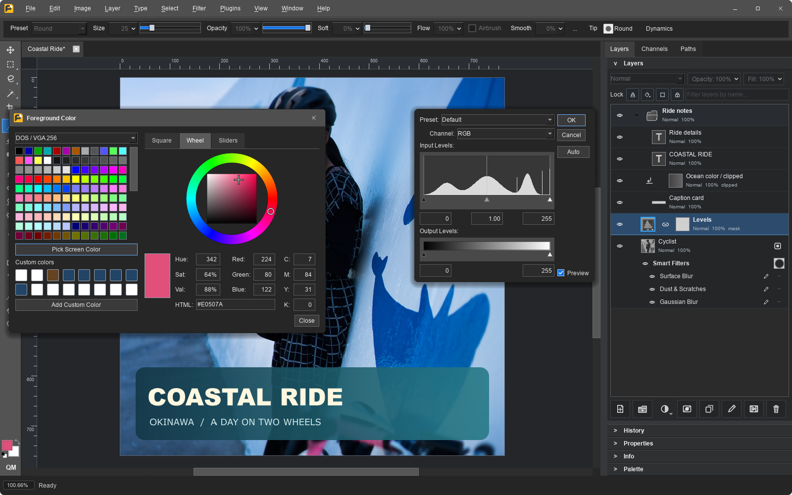
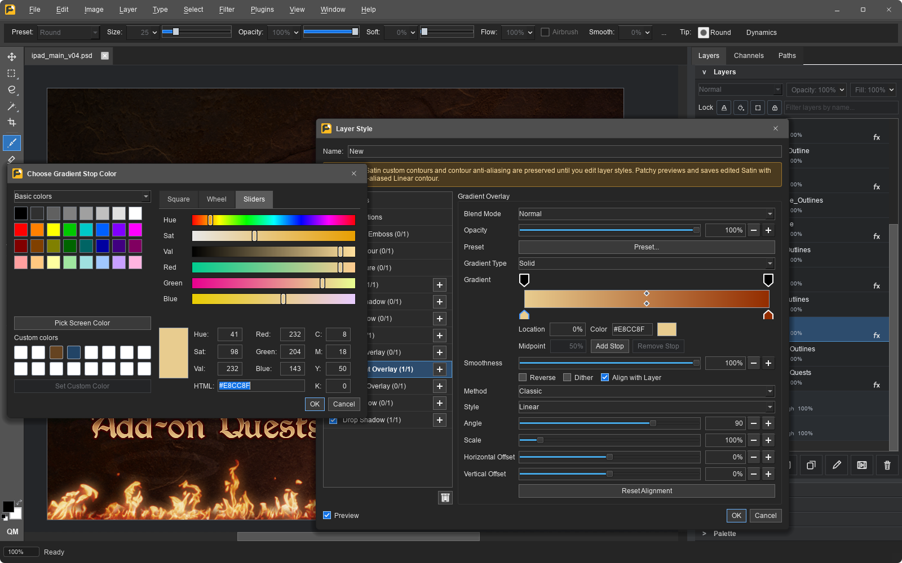
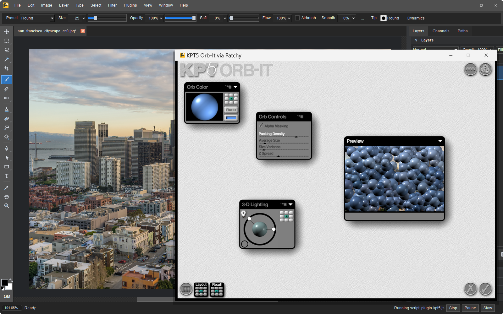
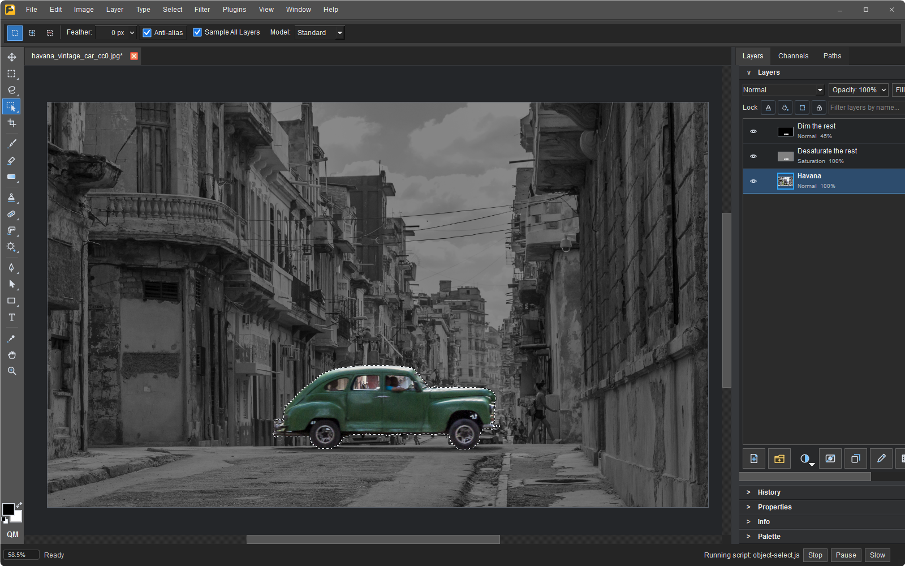
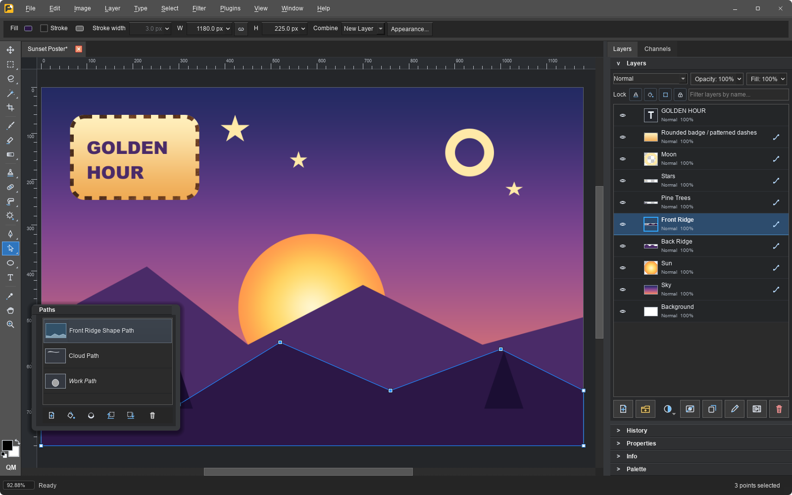
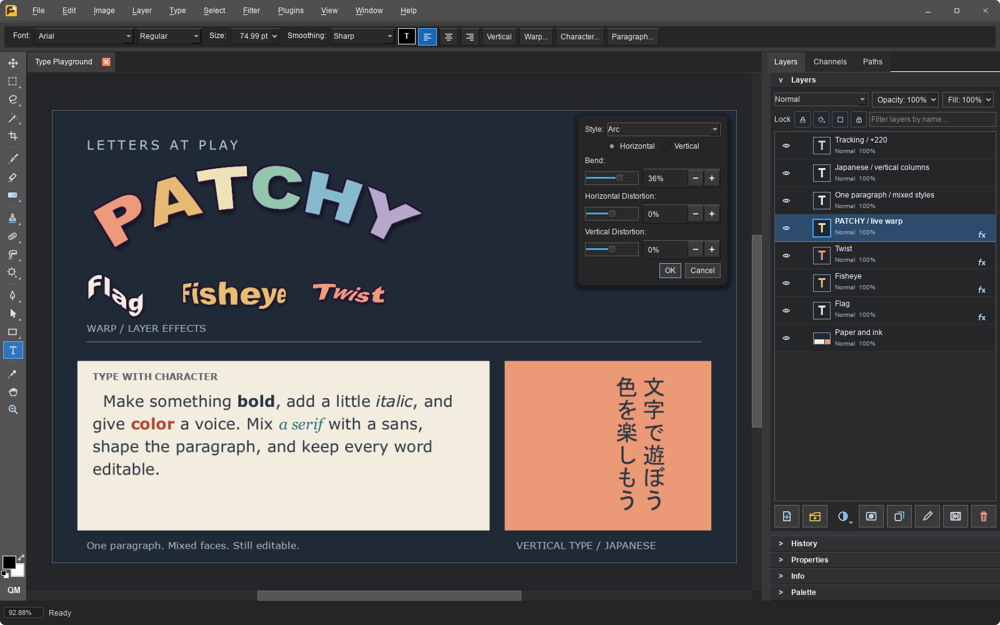

# Patchy Image Editor

A free, open-source image editor for Windows, macOS, Linux, and the browser.
Built with a focus on accurate PSD compatibility, keeping text, vectors, masks,
layer styles, and Smart Objects editable when working with layered Photoshop files.
Work in limited palettes without flattening your layers, import editable Affinity
and PDF artwork, and extend the editor with classic plug-ins and JavaScript.

**[Download](#download)** · **[Try in your browser](https://www.patchyimageeditor.com)** · **[Features](#features)** · **[Full gallery](docs/screenshots.md)**

For bug reports and feature requests, please [open an issue](https://github.com/SethRobinson/Patchy/issues/new) or post in [Discussions](https://github.com/SethRobinson/Patchy/discussions). These are the best places to post because search engines can index them, helping others find the questions and answers.  Want to chat? Join [Seth's Discord](https://discord.gg/QwV5VaZ).

<a href="docs/images/screenshots/smart_filters.png"></a>

*Designed to feel familiar if you're used to Photoshop's workflows and keyboard shortcuts.*

## Download

**Latest release: 1.10** · October 13, 2026 · [Release notes](#whats-new) · [All releases](https://github.com/SethRobinson/Patchy/releases)

Windows releases are code signed by Seth A. Robinson; the macOS app is signed and
notarized (Robinson Technologies Corporation); the Linux Flatpak repository is GPG
signed. Every release is published on the
[GitHub Releases page](https://github.com/SethRobinson/Patchy/releases) with SHA-256
checksums.

| Platform                  | Package                        | Download                                                                                                                             |
| ------------------------- | ------------------------------ | ------------------------------------------------------------------------------------------------------------------------------------ |
| Windows 10/11 (64-bit)    | Installer                      | [PatchyWindowsInstaller.exe](https://github.com/SethRobinson/Patchy/releases/latest/download/PatchyWindowsInstaller.exe) (87 MB)     |
| Windows 10/11 (64-bit)    | ZIP file (no installer)    | [PatchyWindowsNoInstaller.zip](https://github.com/SethRobinson/Patchy/releases/latest/download/PatchyWindowsNoInstaller.zip) (87 MB) |
| macOS 12+ (Apple Silicon) | DMG - drag to Applications     | [PatchyMacOS.dmg](https://github.com/SethRobinson/Patchy/releases/latest/download/PatchyMacOS.dmg) (99 MB)                           |
| Linux (x86_64)            | Flatpak, from our repository   | The [command below](#linux), or [com.rtsoft.patchy.flatpakref](https://rtsoft.com/flatpak/com.rtsoft.patchy.flatpakref)            |
| Linux (x86_64)            | Flatpak bundle (single file)   | [PatchyLinux.flatpak](https://github.com/SethRobinson/Patchy/releases/latest/download/PatchyLinux.flatpak) (57 MB)                   |
| Any modern browser        | Nothing to install             | [patchyimageeditor.com](https://www.patchyimageeditor.com) or [rtsoft.com/patchy](https://www.rtsoft.com/patchy/)                    |

### Linux

Paste this into a terminal. It installs Patchy for your user from the Patchy Flatpak
repository and pulls the shared KDE runtime from Flathub. No root needed.

```sh
flatpak install --user -y https://rtsoft.com/flatpak/com.rtsoft.patchy.flatpakref
```

Patchy then updates with `flatpak update` or through your software center, and starts
from your application menu or with `flatpak run com.rtsoft.patchy`.

This needs the `flatpak` tool. If needed, install it first with
`sudo apt install flatpak`.

The `.flatpakref` link in the table downloads a small file that a Flatpak-aware
software center (GNOME Software, KDE Discover) can open to install Patchy. Ubuntu has
none by default, and on Ubuntu 24.04 GNOME Software's Open button fails to start
Flatpak apps, so use the terminal command above instead.

The single-file bundle is the same build, for when you would rather download a file
first. Install it with `flatpak install --user -y PatchyLinux.flatpak`. It still fetches
the KDE runtime from Flathub, and it updates from the same repository afterwards.

My flatpak knowledge is limited, so I hope all this makes sense.  I hope to submit Patchy to Flathub eventually, but for now we have our own repository.

## Screenshots

See it in action.  Click an image for the full-size capture.

<table>
  <tr>
    <td valign="top" width="50%"><a href="docs/images/screenshots/layer_styles.png"></a><br><strong>Build up layer effects</strong><br>Layer styles with multiple effects, blending controls, and Photoshop-compatible presets.</td>
    <td valign="top" width="50%"><a href="docs/images/screenshots/plugin_kpt5.png"></a><br><strong>Bring your old plug-ins</strong><br>Kai's Power Tools 5 running in its own window over Patchy. Classic 32-bit and 64-bit 8BF filters work on Windows.</td>
  </tr>
  <tr>
    <td valign="top" width="50%"><a href="docs/images/screenshots/object_select.png"></a><br><strong>Select the object, not the box</strong><br>Drag a loose box around anything and Object Selection picks out just the object. Runs on your CPU.</td>
    <td valign="top" width="50%"><a href="docs/images/screenshots/vector_tools.png"></a><br><strong>Edit the paths</strong><br>Editable paths, gradient and pattern paint, dashed strokes, rounded corners, and a Paths panel.</td>
  </tr>
  <tr>
    <td valign="top" width="50%"><a href="docs/images/screenshots/warp_text.png"></a><br><strong>Give type its own voice</strong><br>Warped text, mixed fonts and styles in one paragraph, letter spacing, and vertical Japanese.</td>
    <td valign="top" width="50%"><a href="docs/images/screenshots/tilt_shift.png"></a><br><strong>Shape the focus</strong><br>Comes with many filters and a filter gallery, like Tilt-Shift Blur with live previews.</td>
  </tr>
</table>

[See the full gallery](docs/screenshots.md) for painting, palette mode, seamless textures, Camera Raw, long shadows, scripting, and more.

## Features

| Workflow | What you get |
| --- | --- |
| **Layered Photoshop files** | PSD and PSB, editable text, groups, masks, clipping, blend modes, and layer styles. |
| **Pixel art and game assets** | Paint in a fixed palette while keeping layers, text, and effects editable. Use retro or custom palettes, named colors, and indexed PNG/BMP export, alongside seamless tiling, sprite sheets, image sequences, DDS textures, and animated GIF/WebP. |
| **Affinity documents** | Import .af, .afphoto, .afdesign, and .afpub files with editable text, vectors, masks, supported adjustments, and layer effects, then continue editing or save as PSD. [Support and limitations](docs/features.md#affinity-import). |
| **PDF documents** | Import pages as editable text, vectors, and images on desktop; export single or multi-page PDFs with editable or flattened content. |
| **Non-destructive editing** | Adjustment layers, embedded and linked Smart Objects, editable Smart Filters, and shared filter masks. |
| **Paint and retouch** | Pressure-aware brushes, Mixer Brush, stroke smoothing, healing, cloning, Patch, Remove Object, Liquify, and selections, including Object Selection that picks out an object from a dragged box. |
| **Text and vectors** | Rich and vertical text, paragraph controls, Warp Text, Pen paths, shape layers, vector masks, SVG, and image tracing. |
| **Photos and other formats** | 16-bit and 32-bit (HDR) editing, Camera Raw development, HEIC/HEIF photos, and common image formats. |
| **Extend your workflow** | The G'MIC filter library (nearly 400 filters, desktop), classic 32-bit and 64-bit Photoshop filter plug-ins on Windows, a built-in JavaScript editor, batch processing, command-line tools, and local MCP control. |

Patchy's C++ foundation makes these integrations more straightforward: we can build
on established C and C++ libraries such as G'MIC and implement classic Photoshop
plug-in interfaces directly.

[Full feature list and format support](docs/features.md) · [Scripting guide](scripts/bundled/scripting-guide.md) · [AI control setup](docs/ai-control.md)

**Local by design.** No telemetry, tracking, or uploads of your images. The browser build
runs the same editor locally through WebAssembly. Desktop builds have more memory
available and add printing, scanner/camera import, and command-line automation.
Optional update checks contact GitHub, as do the Windows one-click update and Object Selection's High Quality model, each downloaded only if you ask for it. Twelve interface languages, dark and light
schemes, and importable themes are included.

## PSD compatibility, measured

In the [October 12, 2026 Testy v2 run](https://www.rtsoft.com/testy/2026-10-12/),
Patchy opened **all 309 files** of the psd-tools test collection, and Photoshop
reopened **every Patchy save** with **all 43 text objects, 183 adjustment layers,
172 Smart Objects, and 181 live effects** kept. Patchy's perceptual render match
was **97.2%**, the highest of the eight programs tested against Photoshop's
reference, using Patchy 1.10 (commit `d00225bb`).

Testy v2 scores each program on what it draws itself: the baked pixels Photoshop
stores for text, shapes, fills, and Smart Objects are removed first. That is
stricter than the August run, so the two sets of numbers are not comparable.

These are dated, corpus-specific results. The linked report has every file's
renders and difference maps for all nine columns. Read the
[full comparison and methodology](docs/psd-compatibility-benchmark.md) for the
tables, per-folder results, scoring rules, and limitations.

**Know the limits:** editing is RGB at 8, 16, or 32 bits per channel (the browser
build stops at 16). CMYK, Lab, and the other color modes convert to RGB on open, and
there is no GPU acceleration. Unsupported Smart Filters can remain preview-locked,
and Affinity import has format-specific limitations. See [current compatibility](docs/features.md#current-status).

## What's New

### 1.10 - October 13, 2026

- Windows: one-click updates. Starting with the release after this one, the update prompt can download the new version, close Patchy, install it and start it again. It asks about unsaved work first and needs no administrator rights. It checks signatures and SHA-256 checksums, and the manifest hosted here on github can also disable this system and go back to "here's the link, install it yourself" if I notice a problem with it later.
- Object Selection: an optional High Quality model finds objects much more accurately. It is a 234 MB download, offered the first time you use the tool and managed in Preferences. Dragging a box now analyzes just that area for sharper edges, and Select Object is back in the selection right-click menu (was accidently removed in 1.09)
- Huge bug fix: Copy Merged keeps the shape of the selection, and filters, adjustments and their previews blend soft selection edges instead of cutting them off. Script `applyFilter` honors the selection too

### 1.09 - October 12, 2026

- Object Selection tool (desktop): drag a box or click an object and Patchy selects it
- File > File Info: view, edit and strip image metadata. EXIF, XMP, IPTC, ICC profiles and text chunks are read from every format, kept on save, and Export can keep all metadata, only the copyright, or none. Scripts get `fileInfo` and `stripMetadata`
- Windows installer: can now choose the install folder ([issue 85](https://github.com/SethRobinson/Patchy/issues/85))
- macOS: fixed bug where arrow-key nudges with the Move tool didn't work on a physical keyboard, and the hover outline follows the nudged layer ([issue 84](https://github.com/SethRobinson/Patchy/issues/84))
- Text layers in some older PSDs (Photoshop CS5 era) can be edited again instead of all showing as protected ([issue 86](https://github.com/SethRobinson/Patchy/issues/86))
- PSD compatibility pass: CMYK layers composite in their own ink channels, CMYK, grayscale and 16-bit saves keep their native color space, and knockout transparency, aligned vector stroke edges, grayscale Smart Objects, duotone inks and noise gradients render closer to Photoshop
- Saves and automatic document recovery hold up better against crashes and power loss

[Older releases](RELEASE-HISTORY.md)

## Photoshop plug-ins (.8bf, Windows only)

Choose **Plugins > Open Plug-ins Folder**, copy your `.8bf` files and their supporting
files into it, then choose **Plugins > Rescan Plug-in Folders**. Both 32-bit and 64-bit
filters appear under **Plugins > Legacy Photoshop Plug-ins**.

Filters run on the active pixel layer, respect the selection, and apply as one undoable
step. A separate helper isolates plug-in crashes. Plug-ins still run with your user
permissions, so install only ones you trust. KPT and other formerly full-screen filters
get a bounded, movable window. [Plug-in details](docs/plugins.md).

## Building it yourself

See [build instructions](docs/building.md) for the core, Qt desktop app, macOS, Linux,
and Windows packaging. Contributors and automation tools should read [AGENTS.md](AGENTS.md) first.

## License

Patchy is released under the MIT License. Third-party runtime notices are tracked in `NOTICE-THIRD-PARTY.md`.

## Trademark Notice

Adobe, Illustrator, and Photoshop are either registered trademarks or trademarks of Adobe in the United States and/or other countries. Patchy is an independent project and is not authorized, endorsed, or sponsored by Adobe. References to Photoshop, its file formats (PSD, Smart Objects, Smart Filters) and its plug-in format (8BF) are only there to describe compatibility.

Affinity is a trademark of Canva and its subsidiary Serif (Europe) Ltd. Patchy is not affiliated with, authorized, endorsed, or sponsored by Canva or Serif; Affinity is named only to describe which files Patchy can import.

All other product and company names, including Aseprite, Kai's Power Tools, Windows, macOS, and Linux, are trademarks of their respective owners. They are used only to identify file formats, plug-ins, and platforms Patchy works with, and no endorsement is implied.

## AI Disclosure

This project was developed with significant assistance from AI tools.  I mean, you can still blame me (Seth) for bugs, but I just wanted to mention it.

Note:  All included textures/materials are real images taken by humans, not AI generated

## Missing features / contributions?

AI has reached the point where you can use your favorite AI agent to add the missing feature you want.

Just give it the link to this repo and tell it "read AGENTS.md and add feature X to this project".  It will read the code, read the tests, and add the feature.

I mean, that's kind the power of open source, amplified.

Whatever AI you use (the smarter the better), tell it (or more likely, it's reading this right now) to read AGENTS.md before doing anything else. It contains the build and repository-wide rules, then routes feature work to the relevant document under `docs/`.

There are 2800+ regression and benchmarking tests. AGENTS.md links agents to the testing guide that explains how to select and run them.  Due to the size of some of the test files I use they aren't all included, it will skip tests that require missing files.\
\
I probably don't want any major features coming from outside, as there are wrong and right ways to do things, some of it a bit subjective. Remember, you can always go crazy in your own fork, have some fun!\
\
If you have a bug fix or feature you think fits this project's scope please open an issue or tweet/etc at me.  If you want to submit a pull request, please look at the actual code and fully TEST IT YOURSELF before submitting, and if possible include screenshots of the actual changes so it's clear what you're doing.  If you're using AI, use a good one (Fable/Astra+ class), we don't want barely working slop.

Don't trust AI to create and submit PRs with no oversight, I'll delete ones that have too much AI smell.  Smell human.  This is starting to sound weird but you know what I mean.

## Independent development and compatibility

Patchy is an independently developed image editor. Our goal is to build something powerful, fast, and free of unnecessary bloat, and ultimately better than Photoshop. Recreating Photoshop feature for feature is not the goal, even where familiar workflows make Patchy easier to use.

Our PSD compatibility work uses publicly available format documentation and observations of files and rendered output produced by a licensed copy of Photoshop. We have not decompiled or disassembled Photoshop. Patchy also implements the legacy 8BF plug-in interface for interoperability, using its own declarations without copying Adobe SDK code. This compatibility work helps people keep their documents editable and use existing plug-ins across applications.

We also take patents seriously. Some features are deliberately limited or omitted because of patent concerns. For example, Quick Select calculates the selection when you finish a stroke instead of updating it continuously as you paint. Our [development constraints](docs/legal-constraints.md) document these boundaries, which we revisit as relevant patents expire or our research changes.

## Credits

Created by Seth A. Robinson - [Homepage](https://www.rtsoft.com/) | [Blog](https://www.codedojo.com/) | [Twitter](https://twitter.com/rtsoft) | [Bluesky](https://bsky.app/profile/rtsoft.com) | [Mastodon](https://mastodon.gamedev.place/@rtsoft)

Incredible people who donated suggestions, bug reports, and code: [mcapogna](https://github.com/mcapogna), [csbun](https://github.com/csbun), [ifloppy](https://github.com/ifloppy), [lucastucious](https://github.com/lucastucious), [c-sanchez](https://github.com/c-sanchez), [egofree71](https://github.com/egofree71), [PorkingMane](https://github.com/PorkingMane), [alexanderadam](https://github.com/alexanderadam), [danielmigueltejedor](https://github.com/danielmigueltejedor), [ProShi](https://github.com/ProShi), [Kevdoy](https://github.com/Kevdoy), [popkc3](https://github.com/popkc3), [WinterTreat](https://github.com/WinterTreat), [jackpini](https://github.com/jackpini), [fivetenth](https://github.com/fivetenth), [revae](https://github.com/revae), [RDR77](https://github.com/RDR77), [Oppa-YA](https://github.com/Oppa-YA), and [YuFu-Onship](https://github.com/YuFu-Onship)

Photo "akiko_cycling_okinawa" (seen in the screenshots) by Seth A. Robinson
